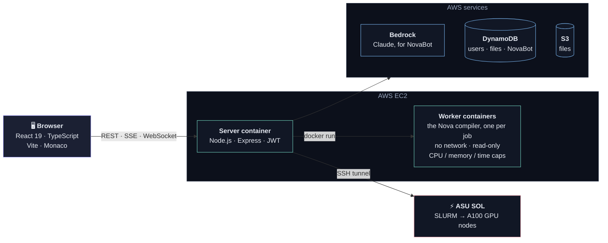
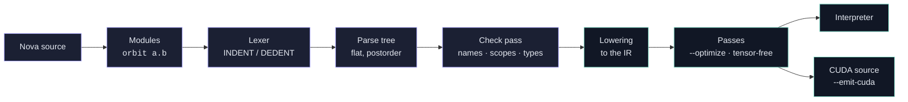
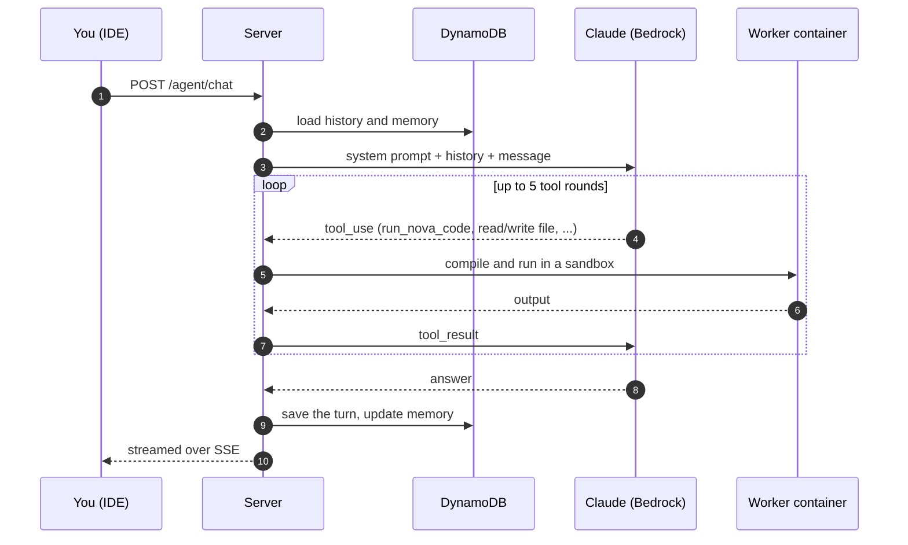
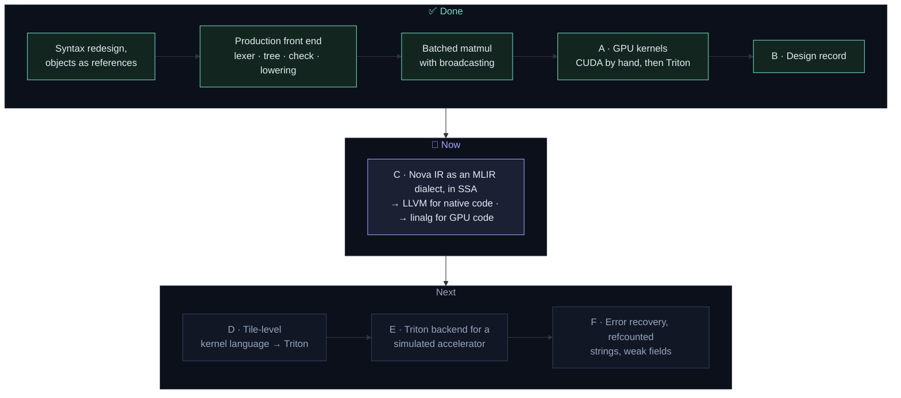

<div align="center">



[](https://github.com/parhitmtech/Nova/actions/workflows/ci.yml)


**[Showcase](docs/showcase/index.html)** · [Quick start](#-quick-start) · [Architecture](#-architecture) ·
[Performance](#-performance) · [Roadmap](#-roadmap) · [Docs](#-documentation)

</div>

**Nova** is a statically typed programming language for machine learning, with Python-style layout and
tensors, autograd and GPU-cluster training built into the language. **NovaComp** is the cloud IDE around
it: a browser editor that compiles and runs Nova in sandboxed containers, streams the output back, and
includes an AI coding assistant.

> **Interactive showcase:** [`docs/showcase/index.html`](docs/showcase/index.html) is a single-file page with a
> live compiler walkthrough, a clickable architecture map and the benchmark charts. Open it in a browser, or
> serve it with GitHub Pages (Settings → Pages → `main` / `docs`) at `https://parhitmtech.github.io/Nova/showcase/`.

```python
orbit novatorch.nn

def scale(x, k):                  # no types written: compiled once per argument-type combination
    return x * k

ignite:                           # the entry point
    Linear layer = Linear(2, 3)
    Tensor h = relu(layer.forward(randn(4, 2)))
    print(h.rows)                 # 4

    Tensor W = randn(3, 2)
    requires_grad(W)
    Tensor loss = mse_loss(ones(4, 3) @ W, zeros(4, 2))
    backward(loss)                # reverse-mode autograd
    print(tensor_grad(W).rows)    # 3

    print(scale(1.5, 2.0))        # 3.000000
```

## 💡 Why Nova

Python is the language of machine learning, but it's dynamically typed and slow, so the heavy lifting
happens in C++/CUDA libraries the language can't see into. Nova makes tensors a built-in type that the compiler
understands, which leaves room for what a library can't do: type-check tensor code before it runs, fuse
and compile tensor ops, and run the same program on a laptop or a GPU cluster.

<table>
<tr>
<td width="33%" valign="top">

**🧮 Tensors in the language**<br>
1–6-dimensional tensors with `+ - * / @`, indexing, slicing and broadcasting, checked by the compiler
before the program runs.

</td>
<td width="33%" valign="top">

**🔁 Autograd built in**<br>
`requires_grad`, `backward` and `tensor_grad`, with `novatorch.nn` / `optim` / `data` in the
standard library.

</td>
<td width="33%" valign="top">

**☁️ One path to the GPU**<br>
Write in the browser, run in a sandbox, train on ASU's SOL A100s with `sol.finetune(...)`.

</td>
</tr>
</table>

## 🧰 What's in the box

| Part | What it does |
|---|---|
| **Language** | Indentation-based syntax; static types (`int`, `float`, `double`, `bool`, `string`, `Tensor`); functions with several return values; generic functions and classes; structs, classes and inheritance; `vector<T>` and `map<K, V>`; modules via `orbit` |
| **Tensors and ML** | 1–6-dimensional tensors with `+ - * / @`, indexing and slicing, activations, losses, reverse-mode autograd, and `novatorch.nn` / `optim` / `data` in the standard library |
| **Compiler** | C++17; a lexer, a flat parse tree, a check pass for names and types, and lowering to an IR; optional optimizations (constant folding, copy propagation, dead-code elimination, loop-invariant code motion, inlining); a compiler pass that frees each tensor after its last use; an interpreter, and CUDA source output |
| **GPU kernels** | Matmul and batched matmul in CUDA, by hand in four steps up to `cp.async` double buffering (82% of cuBLAS on an A100), and the same in Triton (95% of cuBLAS in FP32, up to 100% with tensor cores), with Triton's IR traced stage by stage: [compiler/kernels](compiler/kernels/) |
| **IDE** | React + Monaco editor, file workspace, terminal, REPL, step debugger, sharing, and NovaBot (Claude via AWS Bedrock), which can read, write and run code |
| **Execution** | Each run gets its own network-less, read-only container with CPU, memory, time and process limits |
| **GPU training** | `sol.finetune(...)` submits HuggingFace training jobs to ASU's SOL cluster over SLURM |

## 🚀 Quick start

You need `make`, a C++17 compiler (g++ or clang++) and Node.js 22.12+.

```bash
git clone https://github.com/parhitmtech/Nova.git && cd Nova
make -C compiler                      # builds compiler/build/nova
make -C compiler test                 # the golden language tests

export NOVA_HOME=$PWD/compiler        # where `orbit` finds the standard library
compiler/build/nova examples/xor.nova # trains a 2-layer network on XOR
```

<details>
<summary><b>Compiler flags</b></summary>

| Flag | Does |
|---|---|
| `--check` | Type-check only |
| `--optimize` | Constant folding, copy propagation, dead-code elimination, LICM, inlining |
| `--dump-tree` | Print the parse tree |
| `--dump-ir` | Print the IR |
| `--debug` | Step debugger |
| `--repl` | Interactive session |
| `--emit-cuda` | Write CUDA source |

</details>

To run the whole IDE locally (backend, frontend, Docker workers), follow [docs/SETUP.md](docs/SETUP.md).

## 🏗️ Architecture



The server and worker images are built from the same commit by CI, pushed to GHCR, and run on the EC2 host
with Docker Compose. [docs/ARCHITECTURE.md](docs/ARCHITECTURE.md) has the full picture.

<details>
<summary><b>The compiler pipeline</b></summary>



Generic functions and classes are checked once per copy; the tensor-free pass frees each tensor after its
last use; pure recursive functions are memoized automatically.

</details>

<details>
<summary><b>How NovaBot works</b></summary>



</details>

## 🛡️ Sandboxed execution

Every run gets its own container, and the deadline is enforced inside it, so a job stops even if the
server dies.

| Limit | Value |
|---|---|
| Network | none (`--network=none`) |
| Filesystem | read-only, all capabilities dropped, `no-new-privileges` |
| CPU / memory / processes | 1 CPU · 256 MB · 32 PIDs |
| Concurrency | 5 batch slots, at most 2 per user (REPL: a separate pool of 2) |

## ⚖️ How Nova compares

| | Nova | Python + PyTorch | JAX | Mojo | Julia |
|---|---|---|---|---|---|
| Typing | Static, checked before running | Dynamic | Dynamic (traced) | Static where declared | Dynamic, inferred |
| Tensors | Built-in type | Library | Library | Library | Library (arrays built in) |
| Autodiff | Built in | Library (autograd) | Library (`grad`) | Library | Library (Zygote, Enzyme) |
| Execution | Interpreter (LLVM and IREE planned) | Interpreter + C++/CUDA kernels | XLA compiler | MLIR → native | LLVM JIT |
| Comes with an IDE, sandbox and GPU cluster | ✅ | ❌ | ❌ | ❌ | ❌ |

Nova's lead is integration: one language, editor, sandbox and GPU path. It's a young, single-backend
language and doesn't compete on ecosystem or raw speed yet. [docs/COMPARISON.md](docs/COMPARISON.md) covers
where it fits and which ideas from these projects it should borrow.

## 📊 Performance

### CPU



Like-for-like programs that print the same result in every language; best of 7 runs including process
startup, on an Intel Core Ultra 7 155H (Windows 11). Nova's interpreter is 2–3.5× faster than CPython on
loops and vectors, but about 7.5× slower on function calls. ⚠️ `int_loop` gives the wrong answer because
Nova's `int` is 32-bit and overflows silently.

<details>
<summary><b>The numbers, and how to reproduce them</b></summary>

| Benchmark | Nova | CPython 3.13 | Node 22 | C (gcc -O2) |
|---|---|---|---|---|
| `calls`: naive `fib(30)`, 2.7M calls | 1,004 ms | 134 ms | 56 ms | 17 ms |
| `int_loop`: 3M-iteration arithmetic loop | 134 ms ⚠️ | 486 ms | 54 ms | 17 ms |
| `vector_sum`: fill and sum 1M-element vector | 93 ms | 192 ms | 64 ms | 17 ms |

```bash
python3 compiler/benchmarks/compare/run.py --optimize
```

[docs/BENCHMARKS.md](docs/BENCHMARKS.md) has the method, caveats such as automatic memoization, and the issues
the benchmarks found.

</details>

### GPU matmul





<details>
<summary><b>The numbers</b></summary>

On SOL's NVIDIA A100, share of cuBLAS's speed (all results match cuBLAS):

| Case | Best hand-written CUDA kernel | Triton FP32 | Triton TF32 (tensor cores) |
|---|---|---|---|
| 4096 x 4096 x 4096 | 82% | 95% | 84% (111 TFLOP/s) |
| 64 batched 256³ products | 77% | 112% | 98% |
| 1024 x 1024 x 1024 | 48% | 82% | 90% |

The kernels, what limits each step, and how to run them on SOL are in
[compiler/kernels/README.md](compiler/kernels/README.md).

</details>

## 🗺️ Roadmap



**Done:** the syntax redesign and objects as references, with reference counting; a production front end (a
new lexer, a flat parse tree, a separate check pass, and lowering to the IR); batched matmul with NumPy-style
broadcasting, forward and backward; GPU matmul kernels in CUDA and Triton, measured on A100s; and a
[design record](docs/DESIGN.md) of the decisions so far.

**Now:** Nova IR as an MLIR dialect in SSA form. Its first slice is in `compiler/mlir/`: `!nova.tensor`,
`nova.zeros`, `nova.matmul` and `nova.print`, a `nova-opt` driver, and lit/FileCheck tests. From there it lowers
to native code through LLVM and to GPU code through `linalg`.

**Next:** a tile-level kernel language lowered to Triton, then a Triton backend for a simulated AI accelerator.
The full plan is in [docs/ROADMAP.md](docs/ROADMAP.md).

<details>
<summary><b>Known gaps today</b></summary>

- `int` is 32-bit and overflows silently ([BENCHMARKS.md](docs/BENCHMARKS.md#issues-found), issue 2).
- Some of [docs/SYNTAX.md](docs/SYNTAX.md) is still the *target* design. Not yet implemented: `10_000`
  literals, `t.grad`, `\n` / `\t` escapes, and `print(t)` for tensors. Use `tensor_print(t)` for now.

</details>

## 📚 Documentation

| Doc | For |
|---|---|
| [docs/SYNTAX.md](docs/SYNTAX.md) | The Nova language |
| [docs/ARCHITECTURE.md](docs/ARCHITECTURE.md) | How the IDE, backend, sandbox, NovaBot, SOL and compiler fit together |
| [docs/SETUP.md](docs/SETUP.md) | Running and testing everything locally |
| [docs/DEPLOY.md](docs/DEPLOY.md) | Production deployment on EC2 |
| [docs/ROADMAP.md](docs/ROADMAP.md) | What comes next |
| [docs/DESIGN.md](docs/DESIGN.md) | The compiler's design decisions, with the alternatives and trade-offs |
| [compiler/kernels/README.md](compiler/kernels/README.md) | The GPU matmul kernels and their A100 results |
| [compiler/kernels/triton/IR_WALKTHROUGH.md](compiler/kernels/triton/IR_WALKTHROUGH.md) | Triton's compilation of the matmul, stage by stage |
| [docs/BENCHMARKS.md](docs/BENCHMARKS.md) | Performance numbers, method, and the issues they found |
| [docs/COMPARISON.md](docs/COMPARISON.md) | Nova next to Python/PyTorch, JAX, Mojo, Julia and others |

## 📁 Repository layout

```
compiler/    the Nova language: C++17 compiler, runtime, stdlib, tests, benchmarks, GPU kernels (kernels/)
server/      Node.js + Express backend: auth, execution, workspace, NovaBot
frontend/    React + Vite IDE
examples/    Nova example programs
docs/        the documents above; docs/assets holds the README's graphics
deploy/      Docker Compose and deploy script for the EC2 host
tools/       SOL tunnel scripts, syntax migration scripts, the README graphics generator
```

## 🤝 Contributing

Every pull request runs the 8 required CI checks in [.github/workflows/ci.yml](.github/workflows/ci.yml).
Before you push, run the language tests with and without the optimizer:

```bash
make -C compiler test
NOVA_TEST_ARGS=--optimize make -C compiler test
```

A language change ships with a golden test in `compiler/tests/` (`name.nova` plus `name.expected`, or
`name.error` for a compile error) and an update to [docs/SYNTAX.md](docs/SYNTAX.md).

When benchmark numbers change, update them in `tools/readme/make_assets.py` and run
`python3 tools/readme/make_assets.py docs/assets` to redraw the charts.
